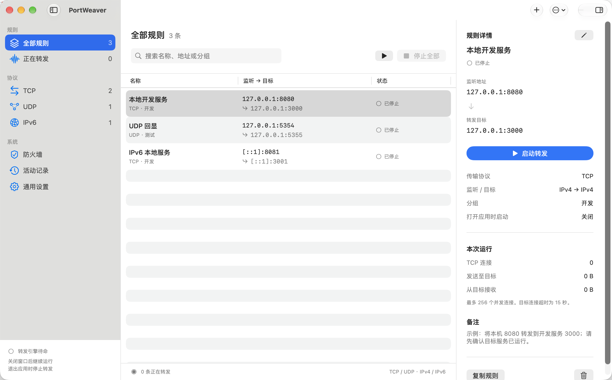

# PortWeaver

原生 macOS TCP / UDP 端口转发规则管理器。SwiftUI 界面，使用 Network.framework 转发，无第三方运行依赖。

[](https://github.com/GetZ110/PortWeaver/actions/workflows/ci.yml)


[](LICENSE)



## 下载与安装

系统要求：macOS 14 或更高。通用版本支持 Apple Silicon 和 Intel Mac。

1. 从 [GitHub Releases](https://github.com/GetZ110/PortWeaver/releases/latest) 下载最新的 `PortWeaver-1.0.0-universal.dmg`。
2. 打开 DMG，将 `PortWeaver.app` 拖入“应用程序”。
3. 从“应用程序”启动 PortWeaver，点击 `+` 创建第一条转发规则。

当前发布包使用 ad-hoc 临时签名，尚未使用 Developer ID 签名和 Apple 公证。跨设备分发时，macOS 可能要求前往“系统设置 → 隐私与安全性”允许打开。正式公开分发应使用有效的 Developer ID 签名、公证并装订公证票据；本工程不包含开发者证书。

## 功能

- TCP 双向转发，背压、64 KiB 流缓冲、FIN 半关闭处理。
- UDP 双向转发，独立客户端会话、报文边界与空报文；空闲 60 秒回收。
- IPv4 → IPv4、IPv4 → IPv6、IPv6 → IPv4、IPv6 → IPv6，目标支持 DNS 主机名。
- 新建、修改、复制、删除、分组、备注、搜索和协议筛选。
- 启停状态、连接数、本次传输字节和错误记录。
- JSON 配置持久化与导入导出；导入的规则默认不启动。
- 常驻状态栏，逐条快捷开关、启动全部、停止全部、恢复主窗口。
- 原生登录项开关（ServiceManagement / SMAppService），与每条规则的自动启动选项配合。
- 一键配置 macOS 应用防火墙：通过系统管理员授权登记并允许当前应用入站。
- 支持系统明暗模式、原生表格、检查器、快捷键与辅助功能标签。

首次启动为空列表，不创建活动监听。“配置 → 添加示例规则”仅添加未启动的示例。`--preview` 仅供界面检查，不持久化，不监听。

## 开发与构建

完整 Xcode（SwiftUI SDK 及其宏插件）可避免仅使用 Command Line Tools 时的插件缺失。脚本会优先选择 `/Applications/Xcode.app/Contents/Developer`，也可通过 `DEVELOPER_DIR` 指定其他安装。

```bash
cd PortWeaver
export DEVELOPER_DIR=/Applications/Xcode.app/Contents/Developer

# 打开完整应用工程
open PortWeaver.xcodeproj

# 测试核心网络引擎与规则处理
xcrun swift test

# 当前架构的 Release .app
./scripts/build-app.sh

# Apple Silicon + Intel 通用 .app 和 DMG
UNIVERSAL=1 ./scripts/build-dmg.sh

# 可选：使用自己的 Developer ID 身份签名
SIGN_IDENTITY='Developer ID Application: Your Name (TEAMID)' UNIVERSAL=1 ./scripts/build-dmg.sh
```

测试使用回环地址上的真实 TCP/UDP socket，覆盖八种协议/地址族组合、UDP 独立客户端和空报文、1 MB TCP 流与半关闭、端口冲突与端口释放，以及输入校验、原子存储和防火墙路径转义。

## 使用

1. 点击 `+`，填写协议、监听 IP/端口、目标 IP/主机名与端口，然后保存。
2. 点击“启动转发”。`127.0.0.1` / `::1` 仅本机访问；`0.0.0.0` / `::` 监听对应地址族的全部接口。
3. 对外提供服务时，在“防火墙”页面点击“自动配置防火墙…”，按系统提示授权。
4. 在“通用设置”开启“登录时自动启动 PortWeaver”，并为需要恢复的规则开启“打开应用时自动启动此规则”。如系统要求批准，前往系统登录项设置允许。
5. 关闭窗口后从状态栏启停。退出应用时停止全部转发，存在活动规则时会确认。

快捷键：⌘N 新建；⌘R 启动当前列表；⇧⌘R 切换选中规则；⌘. 停止全部；⌘O 导入；⇧⌘E 导出；⌘, 设置。键盘快捷键在应用位于前台时有效。

配置位于 `~/Library/Application Support/PortWeaver/rules.json`，原子写入。配置损坏时禁止自动覆盖原文件，并给出修复路径。活动记录仅保存在当前进程内，最多 300 条，不记录数据内容。

## macOS 行为与边界

- 应用在用户登录后运行；转发依赖应用进程，退出或注销会停止。没有安装 root 守护进程，也不提供登录前转发。
- 防火墙按应用放行，不是逐端口 PF 规则。只执行 socketfilterfw 的 `--add` 与 `--unblockapp`，不修改全局防火墙开关，不覆盖“阻止所有传入连接”、PF、VPN、路由器或 MDM 策略。应用移动或重签名后可能需要重新配置。
- IPv6 监听被限定为 IPv6；如需同时接收 IPv4 和 IPv6，为相同端口创建两条不同地址族的规则。
- 用户态代理会建立新的目标连接，不保留原始客户端源 IP；不支持 UDP 广播/组播转发与透明代理。
- 每条 TCP 规则最多 256 个并发连接，UDP 最多 512 个客户端会话；目标连接超时 15 秒。端口占用、接口地址不存在或系统权限限制均在界面中显示错误。
- 当前实现防止常见同端口自环；仍应避免用本机其他地址或 DNS 别名间接指回自身、或让多条规则互相形成循环。
- 系统登录项、防火墙授权与重启后的自动运行需要在安装到固定路径后实机确认。构建检查不会自动改变此 Mac 的登录项与防火墙设置。

## 工程结构

```text
Sources/PortWeaver/          SwiftUI 界面、状态管理、防火墙与登录项
Sources/PortWeaverCore/      规则模型、JSON 存储、网络转发引擎
Tests/PortWeaverCoreTests/   真实 socket 集成测试及规则测试
Resources/                  Info.plist 与应用图标
scripts/                    .app / DMG 构建和图标生成脚本
PortWeaver.xcodeproj/        原生 macOS 应用工程（共享 scheme）
```

该工程从头实现 macOS 网络转发。PortProxyGUI 仅作为功能参考，未复制其 Windows 源码。项目采用 MIT 许可证。

## 界面回归测试

Xcode 工程包含独立的 `PortWeaverUITests`，使用内存示例规则，不读写真实规则、不启动监听、不修改防火墙或登录项：

```bash
DEVELOPER_DIR=/Applications/Xcode.app/Contents/Developer xcodebuild test \
  -project PortWeaver.xcodeproj -scheme PortWeaver \
  -derivedDataPath build/Regression \
  PORTWEAVER_APP_BUNDLE_ID=app.portweaver.mac.regression
```

已验证已停止规则在状态栏仍显示且开关关闭；反复打开主窗口不会创建副本；设置入口切换到同一窗口的设置页；关闭主窗口后可从状态栏恢复。
